<div align="center">

# HierGeo: POI-Grounded Satellite Captions and a Diagnostic Benchmark for Geographically Constrained Earth Observation Retrieval

<p align="center">
  
</p>

Shubham Patle<sup>1</sup> · Muhammad Zaigham Zaheer<sup>1</sup> · [Salman Khan](https://salman-h-khan.github.io/)<sup>1</sup>

<sup>1</sup> Mohamed bin Zayed University of Artificial Intelligence

[](assets/HierGeo_paper.pdf)
[](https://shubhamrpatle.github.io/HierGeo/)
[](data/README.md)

</div>

## 📝 Abstract

Earth-observation (EO) vision–language models are usually trained on category labels or generic synthetic captions, and evaluated on retrieval benchmarks whose queries carry no geographic constraint. **HierGeo** is a resource for studying text-to-image retrieval when the query names a place, such as *"Residential in Luanda, Angola"*.

- **HierGeo-Data** pairs **464,553** sub-metre 512×512 RGB patches from Core-Five with short captions. The patches span **140 countries** and **2,460 country–city pairs**. Each caption is generated by an open vision–language model conditioned on co-located Foursquare points of interest (POIs), and names the patch's city and country.
- **HierGeo-Bench** contains **23,470** templated queries at the country, city and fine-grained-category level. Relevance is derived from metadata over the full corpus, and 4,454 queries have at least one relevant image.

Our reference system routes each query to its country or city shard with a deterministic place parser, then ranks the shard with a fine-tuned CLIP or SigLIP model.

- Fine-tuning SigLIP2-L on HierGeo-Data combined with SkyScript raises mean zero-shot accuracy on seven EO classification benchmarks from 58.47% to 64.26%. It raises RSICD/RSITMD mean recall from 31.46% to 33.17%.
- On HierGeo-Bench, geographic scoping lifts nDCG@10 from below 0.003 to 0.28–0.51.
- A **metadata-only lookup reaches 0.626** and beats every visual model.
- Only CLIP shows a statistically significant gain from fine-tuning (+0.049 nDCG@10).

We release the benchmark together with these shortcut baselines so that future geo-aware EO benchmarks can control for them.

<p align="center">
  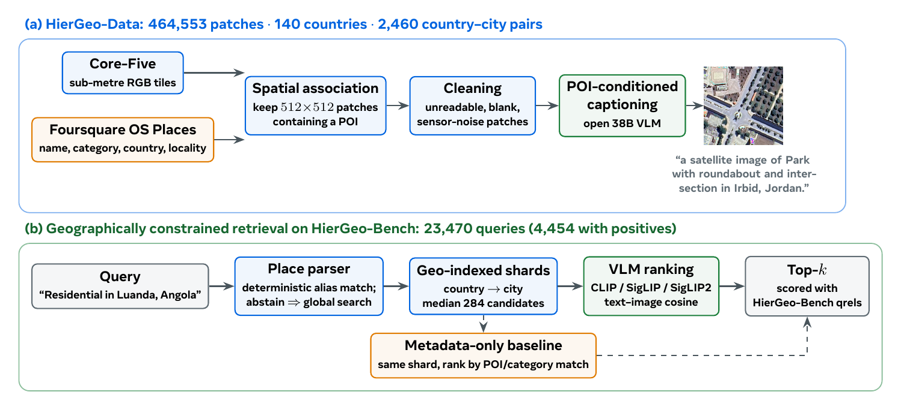
</p>

**Overview of HierGeo.**

- **(a)** HierGeo-Data associates Core-Five imagery with co-located Foursquare POIs and generates one short, place-anchored caption per patch.
- **(b)** HierGeo-Bench evaluates retrieval for queries that name a country or a city. The reference system works in three steps:
  1. It resolves explicit place names deterministically.
  2. It restricts the search to the matching geo-indexed shard.
  3. It ranks the candidates with a vision–language model.

  A metadata-only ranker over the same shard is reported as a shortcut baseline.

## 🔥 Contributions

- **POI-grounded captions at scale.** HierGeo-Data has 464,553 captioned patches from 140 countries. Every caption states a scene category, visible attributes, and the patch's city and country. The location is taken from POI metadata, not inferred from pixels.
- **A diagnostic benchmark for place-constrained retrieval.** HierGeo-Bench has 23,470 queries in three stages: country, city and specialized. Relevance judgments cover the full corpus, and metadata-only baselines are released alongside it.
- **A simple, auditable reference system.** A deterministic place parser routes each query to its country or city shard. Any CLIP-style dual encoder then ranks that shard. Country+city routing shrinks the median candidate set of the scored queries from 464,553 to 284 images.
- **An honest empirical study.** Fine-tuning helps on external classification and retrieval benchmarks. On HierGeo-Bench, however, routing does most of the work, and metadata alone beats every visual ranker. We document these shortcuts as part of the contribution.

## 🛠️ Using the Code

| Component | Location |
| --- | --- |
| Install the environment | [Installation guide](INSTALL.md) |
| Data format, corpus metadata and benchmark files | [Data guide](data/README.md) |
| Fine-tune CLIP / SigLIP / SigLIP2 on HierGeo-Data | [Training guide](docs/TRAINING.md), [trainer](hiergeo/train.py), launchers for [SigLIP2](scripts/train_siglip2.sh), [SigLIP](scripts/train_siglip.sh) and [CLIP](scripts/train_clip.sh) |
| Embed the corpus into a sharded index | [build_index.py](scripts/build_index.py), [multi-GPU launcher](scripts/build_index.sh) |
| Evaluate on HierGeo-Bench (global / country / country+city routing) | [Evaluation guide](docs/EVALUATION.md#hiergeo-bench), [evaluate_bench.py](scripts/evaluate_bench.py) |
| Metadata-only shortcut baselines | [run_metadata_baselines.py](scripts/run_metadata_baselines.py) |
| Paired bootstrap significance tests | [compare_runs.py](scripts/compare_runs.py) |
| Zero-shot classification (7 datasets) and RSICD/RSITMD retrieval | [Evaluation guide](docs/EVALUATION.md#external-benchmarks), [evaluate_external.py](scripts/evaluate_external.py) |
| Deterministic place parser | [hiergeo/routing.py](hiergeo/routing.py) |

### 🚀 Quick Start: Place-Constrained Search

After [installing the environment](INSTALL.md) and [building an index](docs/EVALUATION.md#1-build-an-image-index), you can search from the command line:

```bash
python scripts/search.py "Residential in Luena, Angola" "Industrial in Brazil" "solar farms in South America" \
    --encoder hf_clip --model openai/clip-vit-large-patch14 \
    --embeddings indices/clip/image_embeddings.npy --top-k 5
```

For each query the script prints:

- the route it took: the city shard, the country shard, or global search when no supported country is named;
- the number of candidate images in that route;
- the top-k patches with their captions.

Any CLIP-style checkpoint can be plugged in:

- `--encoder hf_clip`: Hugging Face CLIP.
- `--encoder hf_siglip`: SigLIP or SigLIP2.
- `--encoder open_clip --checkpoint <file.pt>`: RemoteCLIP or SkyCLIP.

## 💡 How HierGeo-Bench Is Built

<p align="center">
  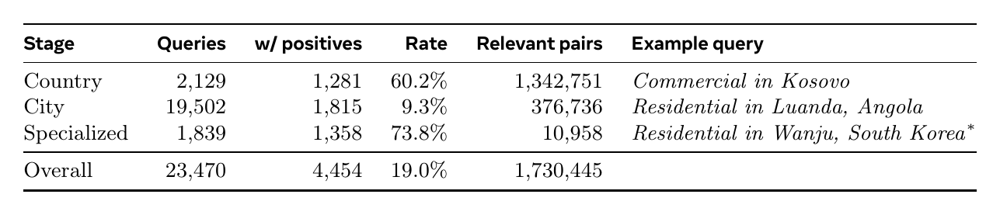
</p>

**HierGeo-Bench composition.** Each query is a scene category plus a place, for example *"Residential in Wanju, South Korea"*.

- **Relevance:** a patch is relevant if its country (and city, when given) matches and its stored category falls in the query's category group.
- **What it certifies:** relevance is derived from metadata. The benchmark therefore measures place-constrained retrieval over a known collection, not independently verified visual relevance.
- **Shortcut baselines:** we always report metadata-only baselines next to the models.

<p align="center">
  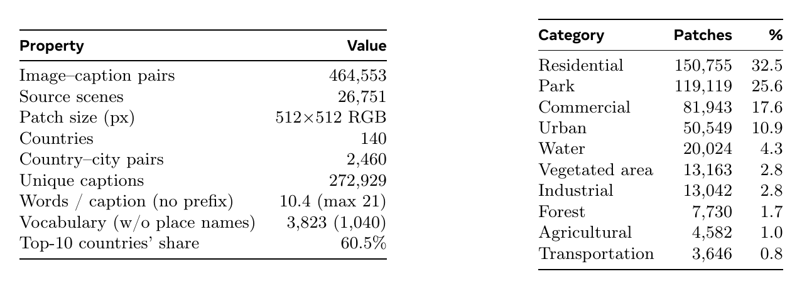
</p>

**HierGeo-Data statistics.** Left: corpus-level properties. Right: the ten scene categories stored with each patch.

## 📊 Main Results

### 🛰️ Zero-shot scene classification

<p align="center">
  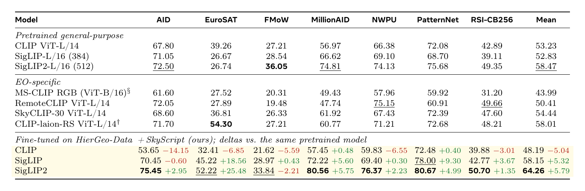
</p>

**Zero-shot scene classification** (top-1 %).

- **Protocol:** one protocol for every row: prompt *"a satellite image of {class}"*, bf16 weights, native resolution, full evaluation splits. All rows except MS-CLIP (§, evaluated with its own code) and CLIP-laion-RS (†, copied from SkyScript because its checkpoint was unavailable) were produced with [`scripts/evaluate_external.py`](scripts/evaluate_external.py).
- **Main result:** fine-tuned SigLIP2 reaches **64.26%**, which is +5.79 points over its initialisation.
- **Fine-tuning data:** all fine-tuned models were trained on HierGeo-Data combined with SkyScript.

### 🔎 Zero-shot cross-modal retrieval

<p align="center">
  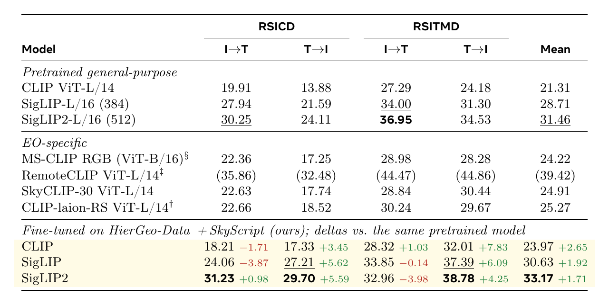
</p>

**Zero-shot retrieval on RSICD and RSITMD** (mean of R@1/5/10).

- **Main result:** all three fine-tuned models improve. Fine-tuned SigLIP2 is the best model not trained in-domain, at 33.17.
- **Direction:** text-to-image gains 3–8 points, while image-to-text changes by −4.0 to +1.0 points.

### 🌍 Place-constrained retrieval on HierGeo-Bench

<p align="center">
  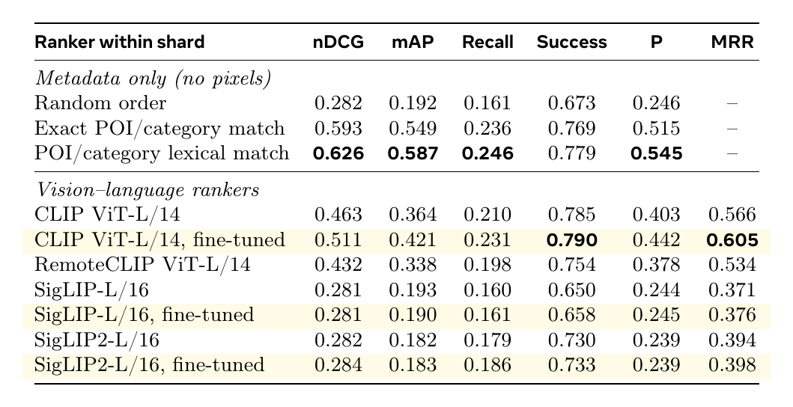
</p>

**Rankers under identical country+city routing** (metrics @10, 4,454 queries with positives).

- **Metadata beats vision:** a metadata-only lexical match reaches 0.626 nDCG@10, above every vision–language model.
- **Random order is a strong reference:** random order within the shard (0.282) already matches the SigLIP family.

<p align="center">
  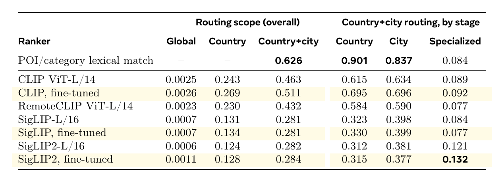
</p>

**Where the performance comes from** (nDCG@10).

| Routing scope | nDCG@10 |
| --- | --- |
| Global (whole corpus) | ≤ 0.003 |
| Country shard | 0.12–0.27 |
| Country + city shard | 0.28–0.51 |

<p align="center">
  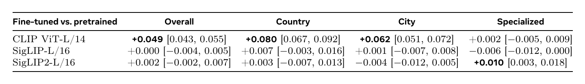
</p>

**Effect of fine-tuning** (change in nDCG@10 with 95% paired-bootstrap intervals).

- **CLIP:** +0.049 overall, the only significant overall gain. Its training captions had place names removed, so the gain reflects category alignment, not geographic knowledge.
- **SigLIP and SigLIP2:** no significant overall change.

## 👀 Qualitative Results

<p align="center">
  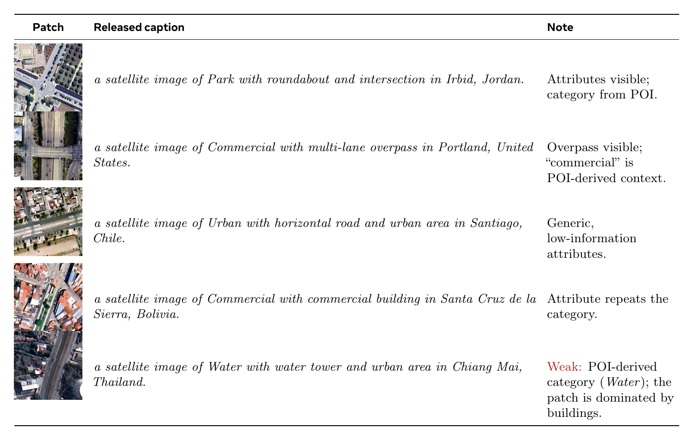
</p>

**Released HierGeo-Data captions.**

- **Location:** always taken from metadata.
- **Category and attributes:** generated, so they can be generic or wrong. In the last example, the POI-derived category *Water* does not match a patch dominated by buildings.

Imagery © respective providers via Core-Five.

## ⚠️ Limitations

Please read Section 6 of the paper before building on these results.

- **Training data:** fine-tuning used HierGeo-Data combined with SkyScript. The external gains therefore cannot yet be attributed to POI-conditioned captions alone.
- **Multi-GPU training bug:** the paper checkpoints were trained with a script that did not synchronise gradients across GPUs. The trainer in this repository fixes this ([`hiergeo/train.py`](hiergeo/train.py) runs the forward pass through `DistributedDataParallel`), but it has not been used to retrain the paper models.
- **Benchmark scope:** relevance is metadata-derived, queries are templated, and the gallery overlaps the training data. The benchmark measures place-constrained retrieval over a known collection, not independently verified visual relevance.

## 🙏 Acknowledgements

HierGeo-Data builds on the [Core-Five](https://huggingface.co/datasets/gajeshladhar/core-five) imagery archive and [Foursquare Open Source Places](https://opensource.foursquare.com/os-places/). Fine-tuning also uses [SkyScript](https://github.com/wangzhecheng/SkyScript).

We thank the authors of [CLIP](https://github.com/openai/CLIP), [SigLIP / SigLIP2](https://github.com/google-research/big_vision), [RemoteCLIP](https://github.com/ChenDelong1999/RemoteCLIP), [OpenCLIP](https://github.com/mlfoundations/open_clip) and [🤗 Transformers](https://github.com/huggingface/transformers) for releasing their models and code. The SkyScript benchmark files are used for the external evaluations.

## 📜 Citation

```bibtex
@misc{patle2026hiergeo,
  title         = {HierGeo: POI-Grounded Satellite Captions and a Diagnostic Benchmark for Geographically Constrained Earth Observation Retrieval},
  author        = {Patle, Shubham and Zaheer, Muhammad Zaigham and Khan, Salman},
  year          = {2026},
  archivePrefix = {arXiv},
  primaryClass  = {cs.CV},
  note          = {arXiv identifier to be added}
}
```

---

<p align="center">
  <a href="https://www.ival-mbzuai.net"></a>
  &nbsp;&nbsp;&nbsp;&nbsp;
  <a href="https://github.com/mbzuai-oryx">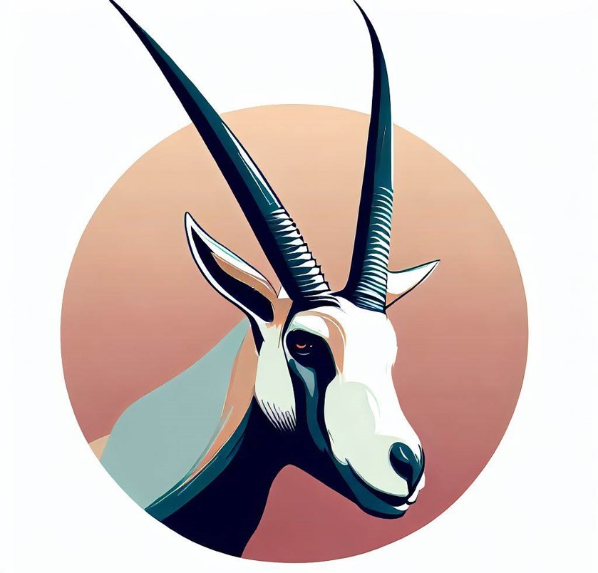</a>
  &nbsp;&nbsp;&nbsp;&nbsp;
  <a href="https://mbzuai.ac.ae">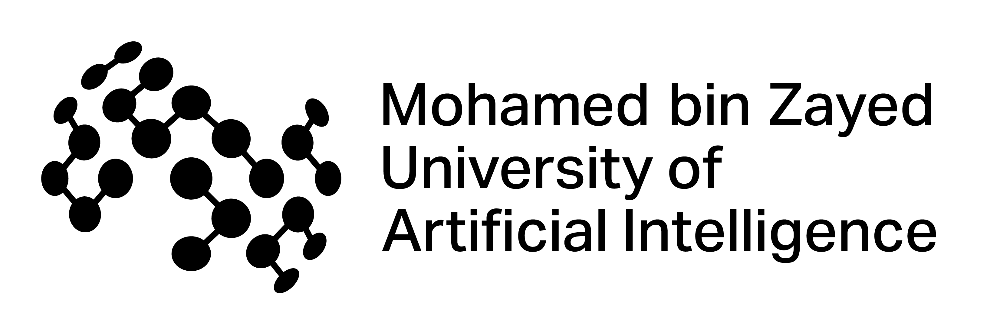</a>
</p>
